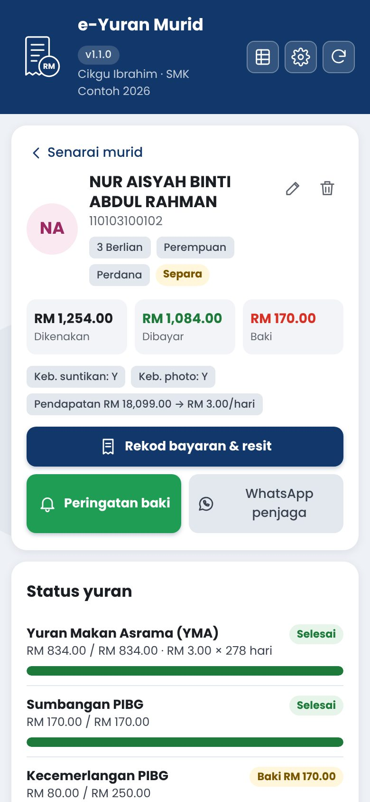

# 🧾 e-Yuran Murid `v1.2.1`

Web app percuma untuk guru merekod bayaran **yuran murid** (YMA, PIBG, dobi dan lain-lain) ke **Google Sheets**, dengan **resit dari WhatsApp ibu bapa** disimpan di Google Drive. Dibina dengan **Google Apps Script**, mesra telefon.

**🔗 Buka app & panduan:** https://g-03355699-tech.github.io/e-yuran-murid/

## Ciri-ciri

- **Satu web app untuk semua guru** — kali pertama dibuka, Sheet *e-Yuran Murid* dicipta automatik dalam Google Drive guru tersebut.
- **Resit dari WhatsApp** — pilih/ambil gambar, pilih PDF, seret fail, atau **tampal (Ctrl+V)** gambar yang disalin dari WhatsApp Web. Gambar dimampatkan di pelayar sebelum dimuat naik.
- **Baca resit automatik (OCR)** — jumlah, tarikh, No. rujukan, bank & kaedah dibaca daripada resit melalui OCR Google Drive dan diisi ke borang (ditanda kuning untuk disemak).
- **Penyata untuk ibu bapa** — PDF penyata yuran setiap murid dalam Drive guru, dikongsi “sesiapa yang ada pautan”, dikemas kini automatik setiap kali bayaran berubah; pautan disertakan dalam mesej WhatsApp. Boleh ditarik balik.
- **Log audit & Sampah** — tab `Log` merekod setiap tambah/ubah/padam (siapa, bila, sebelum → selepas). Bayaran dipadam masuk Sampah dan boleh dipulihkan; padam kekal oleh pentadbir sahaja.
- **Satu resit, banyak yuran** — isi jumlah resit, tekan *Agih automatik* untuk dibahagikan ikut baki setiap yuran. Bayaran ansuran disokong.
- **Ringkasan kutipan** setiap kelas: kutipan, tertunggak, murid selesai, peratus setiap yuran.
- **Senarai murid** dengan carian (nama / No KP) dan tapisan *Belum bayar · Separa · Selesai · Ditaja*.
- **YMA ikut kadar harian** — pendapatan isi rumah < had → kadar rendah (lalai RM1/hari), selainnya kadar biasa (RM3/hari) × bilangan hari (278). Boleh ditetapkan manual setiap murid.
- **Penaja** (Zakat, Yayasan Sarawak, Yayasan Sabah…) untuk semua yuran atau yuran tertentu.
- **WhatsApp** — pengesahan penerimaan bayaran & peringatan baki, siap ditulis.
- **Amaran resit berganda** jika No. rujukan sudah pernah direkod.
- **Import pukal** — salin baris dari Google Sheet lama dan tampal.
- **Jana tab Ringkasan** dalam Google Sheet.
- **Kongsi dengan guru lain** — tambah emel guru (peranan & had kelas), Sheet dikongsi automatik, hantar pautan jemputan `…/exec?sertai=ID` melalui WhatsApp. Guru boleh bertukar antara beberapa Sheet.

## Pemasangan (pembangun)

1. Buka [script.google.com](https://script.google.com/home/projects/create) → **New project**.
2. Salin `Code.gs`, dan `Index.html` (Fail → HTML, nama `Index`).
3. ⚙ **Project Settings** → tandakan *Show "appsscript.json"* → ganti dengan `appsscript.json` dari repo ini (mengaktifkan Drive API v3).
4. **Deploy → New deployment → Web app**
   - *Execute as*: **User accessing the web app**
   - *Who has access*: **Anyone with Google account**
5. Salin URL `…/exec` ke dalam [`docs/config.js`](docs/config.js) — butang *Buka App*, halaman pasang telefon dan kod QR akan menggunakannya.
6. GitHub repo → **Settings → Pages** → Source: *Deploy from a branch*, Branch: `main`, folder `/docs`.

Setiap kali kod dikemas kini: **Deploy → Manage deployments → ✏️ Edit → Version: New version** (URL kekal sama).

### Untuk pengguna baharu

Kali pertama membuka app, guru perlu log masuk akaun Google dan meluluskan kebenaran. Google akan memaparkan **"Google hasn't verified this app"** — tekan **Advanced → Go to e-Yuran Murid (unsafe)**. Jika akaun DELIMa disekat oleh pentadbir domain, gunakan akaun Gmail.

## Struktur Sheet

| Tab | Kandungan |
|---|---|
| `Murid` | No KP, Nama, Kelas, Jantina, Rumah, Kebenaran Suntikan/Photo, Pend Bapa/Ibu, Kadar Harian, Penaja, Yuran Ditaja, No Tel Penjaga, Catatan |
| `Yuran` | Kod, Nama Yuran, Amaun Lelaki/Perempuan, Ikut Kadar Harian, Bil Hari, Susunan, Aktif |
| `Bayaran` | Satu baris setiap yuran; baris dengan **ID** sama = satu resit. Lajur `Dipadam` diisi = dalam Sampah |
| `Guru` | Emel, Nama, Peranan (`ADMIN`/`GURU`), Kelas (kosong = semua) |
| `Tetapan` | Nama sekolah, tahun, had pendapatan, kadar rendah/biasa |
| `ResitData` *(tersembunyi)* | Salinan resit (base64, dipecah 45k aksara) supaya semua guru yang dikongsi boleh melihat resit |
| `Log` | Masa, Oleh, Tindakan, No KP, Nama, Butiran |
| `Ringkasan` | Dijana dari app |

Resit asal disimpan dalam folder **Resit e-Yuran Murid** dan penyata dalam folder **Penyata e-Yuran Murid** di Drive guru (skop `drive.file`).

> **Naik taraf dari v1.1:** v1.2 menambah skop `script.external_request` (untuk membaca teks OCR). Selepas deploy versi baharu, setiap guru perlu meluluskan kebenaran sekali lagi. Lajur & tab baharu (`Dipadam`, `Penyata ID`, `Log`) ditambah secara automatik.

## Had

- App yang belum disahkan Google (*unverified*) dihadkan kepada sekitar 100 pengguna baharu.
- Penyata yang dicipta oleh guru A tidak boleh dikemas kini oleh guru B (had skop `drive.file`); app akan mencipta pautan baharu dan memaklumkan guru untuk menghantarnya semula.
- Peranan & had kelas dikuatkuasakan dalam app; guru yang dikongsi masih mempunyai akses edit terus pada Sheet.
- Pendapatan isi rumah & No. KP ialah data peribadi — kongsi Sheet hanya dengan guru yang perlu.

## Lesen

[MIT](LICENSE)

---

Dibangunkan oleh **Ibrahim bin Kadri (9M2IBR)**.
