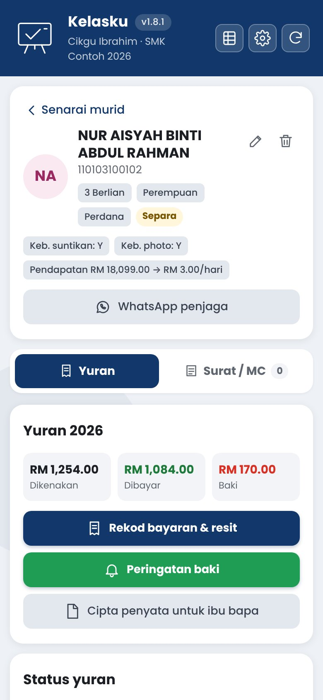

# 🏫 Kelasku `v2.0.0`

*Dahulu dikenali sebagai **e-Yuran Murid**.* Pembantu digital guru kelas: yuran murid & resit WhatsApp, eviden surat / MC, dan lebih banyak modul akan datang.

Web app percuma untuk **guru kelas**: rekod bayaran **yuran murid** (YMA, PIBG, dobi dan lain-lain) dengan **resit dari WhatsApp ibu bapa**, dan simpan **eviden surat sakit / MC** — semuanya dalam **Google Sheets** & Google Drive guru sendiri. Dibina dengan **Google Apps Script**, mesra telefon.

**🔗 Buka app & panduan:** https://g-03355699-tech.github.io/kelasku/

## Ciri-ciri

Halaman setiap murid mempunyai **tab modul**: *Yuran* dan *Surat / MC*. Modul baharu akan ditambah sebagai tab seterusnya.

### Modul Yuran & resit

- **Resit dari WhatsApp** — pilih/ambil gambar, pilih PDF, seret fail, atau **tampal (Ctrl+V)** gambar yang disalin dari WhatsApp Web. Gambar dimampatkan di pelayar sebelum dimuat naik.
- **Baca resit automatik (OCR)** — jumlah, tarikh, No. rujukan, bank & kaedah dibaca daripada resit melalui OCR Google Drive dan diisi ke borang (ditanda kuning untuk disemak).
- **Satu resit, banyak yuran** — isi jumlah resit, tekan *Agih automatik* untuk dibahagikan ikut baki setiap yuran. Bayaran ansuran disokong.
- **Ringkasan kutipan** setiap kelas: kutipan, tertunggak, murid selesai, peratus setiap yuran.
- **Senarai murid** dengan carian (nama / No KP) dan tapisan *Belum bayar · Separa · Selesai · Ditaja*.
- **YMA ikut kadar harian** — pendapatan isi rumah < had → kadar rendah (lalai RM1/hari), selainnya kadar biasa (RM3/hari) × bilangan hari (278). Boleh ditetapkan manual setiap murid.
- **Penaja** (Zakat, Yayasan Sarawak, Yayasan Sabah…) untuk semua yuran atau yuran tertentu. Yuran yang ditaja **tetap dikenakan penuh** supaya kutipan tally; bayaran penaja direkod dengan kaedah *Tajaan / Penaja* (butang *Rekod bayaran penaja* mengisi borang secara automatik). Baki dibahagi kepada *baki ibu bapa* dan *menunggu penaja* — peringatan WhatsApp hanya meminta bahagian ibu bapa.
- **Akaun bayaran setiap yuran** — bank, No. akaun & nama pemegang ditetapkan dalam Tetapan; dipaparkan dalam mesej WhatsApp (dikumpul ikut akaun), penyata ibu bapa dan borang bayaran. OCR memadankan akaun penerima dalam resit untuk mengagihkan bayaran kepada yuran yang betul.
- **Peringatan pukal WhatsApp** — pilih murid *Belum bayar / Separa* dalam kelas, kemudian tekan **Hantar** bagi setiap penjaga; mesej peribadi (baki, akaun bayaran, pautan penyata) sudah siap, dan app terus ke penjaga seterusnya. Pilih *penjaga utama sahaja* atau *bapa & ibu*; murid yang sudah diingatkan dalam N hari dilangkau. Tarikh peringatan direkodkan. Butang *Salin makluman am* untuk Senarai Siaran.
- **WhatsApp** — pengesahan penerimaan bayaran & peringatan baki, siap ditulis.
- **Amaran resit berganda** jika No. rujukan sudah pernah direkod.
- **Penyata untuk ibu bapa** — PDF penyata yuran setiap murid dalam Drive guru, dikongsi “sesiapa yang ada pautan”, dikemas kini automatik setiap kali bayaran berubah; pautan disertakan dalam mesej WhatsApp. Boleh ditarik balik.
- **Cetak resit penerimaan** — butang 🖨 pada setiap bayaran: pratonton resit (No. resit, murid, butiran yuran, jumlah dalam angka & perkataan, kaedah/bank/rujukan, catatan, dan lampiran gambar resit pembayaran), kemudian *Cetak* (A4) atau *Muat turun PDF*.
- **Jana tab Ringkasan** dalam Google Sheet.

### Modul Surat / MC ketidakhadiran

- **Simpan eviden** — buka murid → tab *Surat / MC* → *Simpan surat / MC*: tarikh tidak hadir (dari–hingga), jenis surat (*Surat sakit / MC · Surat ibu bapa · Surat rasmi / pertandingan · Lain-lain*), catatan (tampal mesej WhatsApp ibu bapa) dan satu atau lebih gambar/PDF (pilih, ambil gambar, Ctrl+V atau seret).
- **Baca surat automatik (OCR)** — tarikh tidak hadir (julat *dari–hingga* atau tarikh + bil. hari), jenis surat, klinik dan sebab/diagnosis diisi automatik (ditanda kuning untuk disemak). Amaran jika nama murid tidak dijumpai dalam surat.
- **Senarai eviden kelas** — butang *Eviden surat / MC ketidakhadiran* menyenaraikan semua surat bagi kelas, dengan carian & tapisan bulan.
- **Storan** — fail asal dalam folder Drive *Eviden Surat Kelasku / <kelas>*, rekod dalam tab `Surat`; guru lain yang dikongsi boleh melihat fail. Pilihan WhatsApp pengesahan “surat telah diterima”.
- Kehadiran harian **tidak** direkod — gunakan sistem kehadiran sedia ada.

### Umum

- **Satu Google Sheet setiap tahun** — *Tetapan → Tahun persekolahan baharu*: Sheet baharu (cth. *Kelasku 2027*) dicipta dengan tetapan, jenis yuran, akaun bayaran & senarai guru disalin (boleh diubah kemudian), dan dikongsi dengan guru yang sama. Murid tidak dibawa.
- **Pilih tahun** — senarai juntai bawah *Tahun persekolahan* di halaman utama untuk membuka rekod tahun sebelumnya (lihat, cetak resit & surat). Guru yang masih di tahun lama dimaklumkan dan boleh terus ke tahun terkini.
- **Import murid dari fail APDM** (.xls / .xlsx) — app membaca nama, No. KP, jantina, tingkatan & kelas (cth. *3 BERLIAN*), no. telefon & pendapatan penjaga 1/2; guru memilih kelas yang ingin diimport. Hanya lajur tersebut dibaca; fail sementara dipadam serta-merta.
- **Satu web app untuk semua guru** — kali pertama dibuka, Sheet *Kelasku* dicipta automatik dalam Google Drive guru tersebut.
- **Dua nombor penjaga** (bapa / ibu) — butang WhatsApp bertanya nombor mana. Jika tiada nombor dalam Sheet, guru boleh taip nombor (dan simpan ke Sheet) atau pilih kenalan/chat terus dalam WhatsApp; import no. telefon secara pukal (No KP, tel bapa, tel ibu).
- **Kongsi dengan guru lain** — tambah emel guru (peranan & had kelas), Sheet dikongsi automatik, hantar pautan jemputan `…/exec?sertai=ID` melalui WhatsApp. Guru boleh bertukar antara beberapa Sheet.
- **Log audit & Sampah** — tab `Log` merekod setiap tambah/ubah/padam (siapa, bila, sebelum → selepas). Bayaran dipadam masuk Sampah dan boleh dipulihkan; padam kekal oleh pentadbir sahaja.
- **Import pukal** — salin baris dari Google Sheet lama dan tampal.

## Pemasangan (pembangun)

1. Buka [script.google.com](https://script.google.com/home/projects/create) → **New project**, namakan **Kelasku** (nama ini dipaparkan pada skrin kebenaran Google).
2. Salin `Code.gs`, `Index.html` (Fail → HTML, nama `Index`) dan `App.html` (Fail → HTML, nama `App`). `App.html` mengandungi kod JavaScript app — ia dimuatkan oleh `Index.html` melalui `google.script.run` untuk mengelakkan pepijat HtmlService apabila satu fail HTML terlalu besar.
3. ⚙ **Project Settings** → tandakan *Show "appsscript.json"* → ganti dengan `appsscript.json` dari repo ini (mengaktifkan Drive API v3).
4. **Deploy → New deployment → Web app**
   - *Execute as*: **User accessing the web app**
   - *Who has access*: **Anyone with Google account**
5. Salin URL `…/exec` ke dalam [`docs/config.js`](docs/config.js) — butang *Buka App*, halaman pasang telefon dan kod QR akan menggunakannya.
6. GitHub repo → **Settings → Pages** → Source: *Deploy from a branch*, Branch: `main`, folder `/docs`.

Setiap kali kod dikemas kini: **Deploy → Manage deployments → ✏️ Edit → Version: New version** (URL kekal sama).

### Untuk pengguna baharu

Kali pertama membuka app, guru perlu log masuk akaun Google dan meluluskan kebenaran. Google akan memaparkan **"Google hasn't verified this app"** — tekan **Advanced → Go to Kelasku (unsafe)**. Jika akaun DELIMa disekat oleh pentadbir domain, gunakan akaun Gmail.

## Struktur Sheet

| Tab | Kandungan |
|---|---|
| `Murid` | No KP, Nama, Kelas, Jantina, Rumah, Kebenaran Suntikan/Photo, Pend Bapa/Ibu, Kadar Harian, Penaja, Yuran Ditaja, No Tel Penjaga (bapa), No Tel Penjaga 2 (ibu), Peringatan Terakhir, Catatan, Penyata ID |
| `Yuran` | Kod, Nama Yuran, Amaun Lelaki/Perempuan, Ikut Kadar Harian, Bil Hari, Susunan, Aktif, Bank Bayaran, No Akaun, Nama Akaun |
| `Bayaran` | Satu baris setiap yuran; baris dengan **ID** sama = satu resit. Lajur `Dipadam` diisi = dalam Sampah |
| `Guru` | Emel, Nama, Peranan (`ADMIN`/`GURU`), Kelas (kosong = semua) |
| `Tetapan` | Nama sekolah, tahun, had pendapatan, kadar rendah/biasa, arahan bayaran |
| `ResitData` *(tersembunyi)* | Salinan resit (base64, dipecah 45k aksara) supaya semua guru yang dikongsi boleh melihat resit |
| `Surat` | ID, No KP, Nama, Kelas, Tarikh Mula/Akhir, Jenis, Catatan, Fail (pautan Drive), Direkod Oleh, Masa, Dipadam |
| `Log` | Masa, Oleh, Tindakan, No KP, Nama, Butiran |
| `Ringkasan` | Dijana dari app |

Resit asal disimpan dalam folder **Resit Kelasku** dan penyata dalam folder **Penyata Kelasku** di Drive guru (skop `drive.file`).

> **Naik taraf dari v1.1:** v1.2 menambah skop `script.external_request` (untuk membaca teks OCR). Selepas deploy versi baharu, setiap guru perlu meluluskan kebenaran sekali lagi. Lajur & tab baharu (`Dipadam`, `Penyata ID`, `Log`) ditambah secara automatik.

## Had

- App yang belum disahkan Google (*unverified*) dihadkan kepada sekitar 100 pengguna baharu.
- Penyata yang dicipta oleh guru A tidak boleh dikemas kini oleh guru B (had skop `drive.file`); app akan mencipta pautan baharu dan memaklumkan guru untuk menghantarnya semula.
- Peranan & had kelas dikuatkuasakan dalam app; guru yang dikongsi masih mempunyai akses edit terus pada Sheet.
- Pendapatan isi rumah & No. KP ialah data peribadi — kongsi Sheet hanya dengan guru yang perlu.

## Lesen

[MIT](LICENSE)

---

Dibangunkan oleh **Ibrahim bin Kadri (9M2IBR)**.
